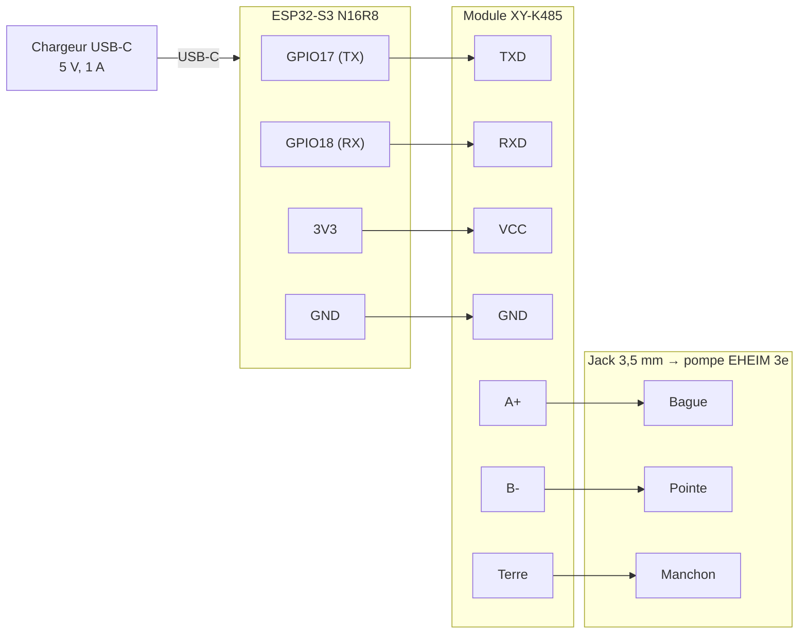

# eheim-3e-esphome

Supervision d'un filtre extérieur **EHEIM professionel 3e** avec un **ESP32-S3** sous **ESPHome**, intégré à **Home Assistant**.

La pompe est lue directement par sa prise jack (bus RS485), sans le logiciel Windows EHEIM ControlCenter ni le câble USB d'origine.

---

## Sommaire

- [Fonctions](#fonctions)
- [Matériel](#matériel)
- [Schéma de branchement](#schéma-de-branchement)
- [Correspondance des broches](#correspondance-des-broches)
- [Installation](#installation)
- [Entités dans Home Assistant](#entités-dans-home-assistant)
- [Tester la pompe depuis un PC](#tester-la-pompe-depuis-un-pc)
- [Dépannage](#dépannage)
- [Protocole](#protocole)
- [Avertissement](#avertissement)

---

## Fonctions

Testé sur un **2076 (professionel 3e 450), firmware 3.80**. Devrait fonctionner avec les **2074 (350)** et **2078 (700)**.

- **Débit** : débit mesuré, débit de consigne, débit relatif (%)
- **Moteur** : vitesse du rotor, palier de débit actuel
- **Mode** : flux constant, Bio 12 h, Stream (pulsé), manuel
- **Entretien** : temps de fonctionnement, heures depuis et avant l'entretien, date du prochain entretien, encrassement (compteur)
- **Alertes** : erreur rotor, erreur air, erreur température, consigne non atteinte, débit faible (< 70 % de la consigne pendant 10 min)
- **Commande** : réglage du palier de débit en flux constant (0 à 14)
- **Page web locale** sur l'ESP32 (`http://eheim-3e.local`), utilisable sans Home Assistant

---

## Matériel

| # | Élément | Rôle | Remarques |
|---|---|---|---|
| 1 | Filtre **EHEIM professionel 3e** (2074, 2076 ou 2078) | appareil supervisé | prise jack 3,5 mm sur la tête de pompe |
| 2 | **ESP32-S3 DevKit N16R8** (ESP32-S3-WROOM-1, 16 Mo flash, 8 Mo PSRAM) | microcontrôleur | tout ESP32 avec une UART libre convient ; broches données pour la N16R8 |
| 3 | Carte d'extension à borniers à vis pour ESP32-S3 | câblage sans soudure | facultative mais pratique |
| 4 | Module **TTL ↔ RS485 XY-K485** (3,3 V / 5 V, sens automatique) | interface avec le bus de la pompe | pas de broche DE/RE à piloter |
| 5 | Fiche **jack 3,5 mm mâle stéréo (3 points)** avec bornier à vis | connexion à la pompe | ou un câble audio jack coupé |
| 6 | Chargeur **USB-C 5 V, 1 A minimum** + câble USB-C de qualité | alimentation de l'ESP32 | un câble trop fin provoque des redémarrages |
| 7 | Fils Dupont / fils de câblage | liaisons ESP32 ↔ module | |
| 8 | *(facultatif)* **EHEIM Interface 4020740** (câble USB d'origine) | test du protocole depuis un PC | inutile une fois l'ESP32 en place |
| 9 | *(facultatif)* Boîtier | protection près de l'aquarium | prévoir l'aération et éloigner de l'eau |

---

## Schéma de branchement



Version texte :

```
 Chargeur USB-C 5 V ──► ESP32-S3
                        ┌──────────────┐        ┌──────────────┐        ┌──────────────────┐
                        │ GPIO17 (TX) ─┼───────►│ TXD          │        │ Jack 3,5 mm      │
                        │ GPIO18 (RX) ─┼───────►│ RXD      A+ ─┼───────►│ Bague            │
                        │ 3V3 ─────────┼───────►│ VCC      B- ─┼───────►│ Pointe           │
                        │ GND ─────────┼───────►│ GND   Terre ─┼───────►│ Manchon (GND)    │
                        └──────────────┘        └──────────────┘        └──────────────────┘
                           ESP32-S3                 XY-K485               Pompe EHEIM 3e
```

> **Ne pas alimenter l'ESP32 par le jack de la pompe** : ses trois contacts servent aux données (A, B) et à la masse.

---

## Correspondance des broches

### ESP32-S3 ↔ module XY-K485

| Broche ESP32-S3 | Broche XY-K485 | Rôle |
|---|---|---|
| **GPIO17** | TXD | envoi des trames vers la pompe |
| **GPIO18** | RXD | réception des réponses de la pompe |
| **3V3** | VCC | alimentation du module |
| **GND** | GND | masse commune |

Sur le XY-K485, TXD et RXD sont nommés du point de vue du microcontrôleur : on relie **TX à TXD** et **RX à RXD**, sans croiser.

### Module XY-K485 ↔ jack de la pompe

| Borne XY-K485 | Contact du jack | Signal |
|---|---|---|
| **A+** | bague | RS485 A |
| **B-** | pointe | RS485 B |
| **Terre** | manchon | GND |

Brochage repris du projet Hackaday « Eheim Pro 3e Control ». Inverser A et B ne casse rien.

### Broches à éviter sur la N16R8

| Broches | Raison |
|---|---|
| 35, 36, 37 | PSRAM octale |
| 19, 20 | USB natif |
| 43, 44 | UART0 (logs) |
| 0, 45, 46 | broches de démarrage |

---

## Installation

1. Copier `esphome/eheim-3e.yaml` et `esphome/eheim3e.h` dans le dossier ESPHome (`/config/esphome/` sous Home Assistant).
2. Copier `esphome/secrets.yaml.example` en `secrets.yaml` et le remplir (Wi-Fi, clé API, mots de passe OTA et page web).
3. Dans **ESPHome Device Builder** : **Install** → « Brancher sur cet ordinateur » pour le premier flashage par USB (Chrome ou Edge), puis « Sur le réseau » pour les mises à jour suivantes.
   - Si le flashage échoue : maintenir **BOOT**, appuyer brièvement sur **RST**, relâcher **BOOT**, recommencer.
4. Ajouter l'appareil dans Home Assistant (notification « Nouvel appareil découvert ») avec la clé API.
5. Câbler la pompe (voir le schéma) et vérifier que **Pompe connectée** passe à ON.

Un seul maître sur le bus : le logiciel ControlCenter et l'ESP32 ne peuvent pas être branchés en même temps (la pompe n'a qu'une prise jack).

---

## Entités dans Home Assistant

| Type | Entités |
|---|---|
| Capteurs | débit de consigne, débit mesuré, débit relatif, vitesse rotor, palier actuel, temps de fonctionnement, heures depuis entretien, heures avant entretien, encrassement (compteur), mode, prochain entretien |
| Alertes | pompe en marche, erreur rotor, erreur air, erreur température, consigne non atteinte, débit faible |
| Diagnostic | pompe connectée, firmware pompe, type de pompe, courant (brut), mode (bits bruts), signal Wi-Fi |
| Commandes | palier débit (flux constant), redémarrer |

---

## Tester la pompe depuis un PC

Avec le câble USB d'origine (EHEIM Interface 4020740), ControlCenter fermé :

```
pip install pyserial
python tools/eheim3e_test.py COM3
```

Remplacer `COM3` par le port affiché dans le Gestionnaire de périphériques (« USB Serial Port »). Le script ne fait que lire : firmware, type de pompe, puis les données toutes les 2 secondes, avec les valeurs converties (débit, vitesse, heures, mode).

---

## Dépannage

| Symptôme | Piste |
|---|---|
| « Pompe connectée » reste à OFF | inverser A+ et B- ; puis inverser TXD et RXD ; vérifier la masse commune |
| Le port COM n'apparaît pas au flashage | essayer l'autre prise USB-C de la carte ; utiliser Chrome ou Edge |
| Redémarrages de l'ESP32 | chargeur ou câble USB trop faible |
| « Consigne non atteinte » permanente | restriction hydraulique (robinets, crépine, tuyaux, masse filtrante) : la pompe tourne au maximum sans atteindre le débit demandé |

---

## Protocole

Liaison RS485 half-duplex à 115200 bauds, 8N1. Trames : `0x55 | adresse | longueur | commande | données`, sans checksum.

Description complète (commandes, structure des données, mot de mode, tables de débit) : [docs/protocole.md](docs/protocole.md)

---

## Avertissement

Projet personnel, non affilié à EHEIM GmbH & Co. KG. EHEIM et professionel sont des marques de leurs propriétaires. Le protocole a été documenté à des fins d'interopérabilité ; aucun fichier du logiciel EHEIM n'est distribué ici. L'envoi de commandes d'écriture à la pompe se fait à vos risques : commencez toujours en lecture seule.

## Licence

MIT, voir [LICENSE](LICENSE).
